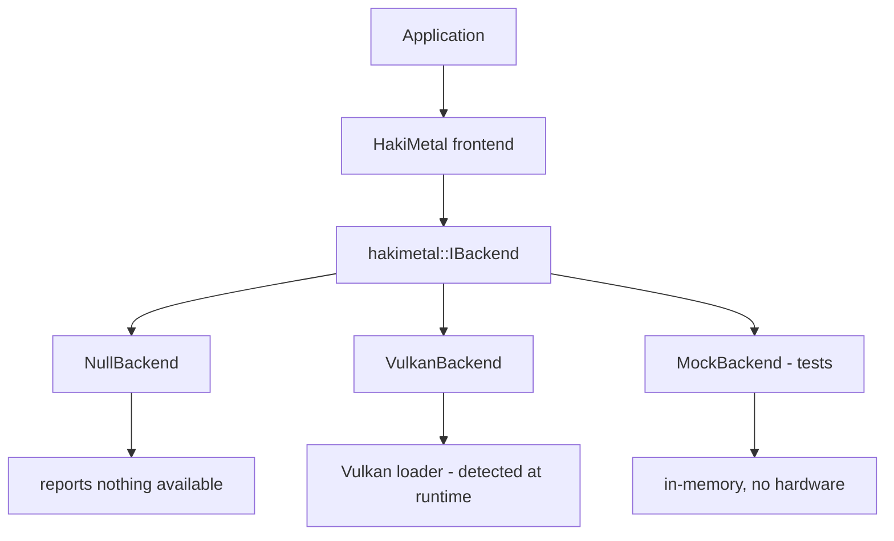

# HakiMetal architecture

**Status: Phase 1 -- architecture and a prototype. No backend talks to hardware.** The Vulkan backend
detects Vulkan and reports what it can do; it does not create a device unless asked, and it performs no
GPU register writes. The Adreno 642L driver is not touched.

## What HakiMetal is

HakiMetal is an experimental, backend-independent graphics API for HakiOS. It takes the object model of
Apple's *documented* Metal concepts -- device, command queue, command buffer, render pipeline, buffer,
texture, fence, event -- and puts them behind a backend interface so that a backend can be Vulkan,
something else, or nothing at all.

It is **not**:

* not Apple Metal, and not compatible with it. No Metal source or binary compiles against it unchanged;
* not a port of Apple's implementation. Apple publishes concepts, not code;
* not a Vulkan wrapper. Vulkan is one possible backend, and it is not assumed to exist;
* not a driver. Nothing here writes GPU registers.

## The three layers



**Frontend** (`include/hakimetal/`). The objects an application holds: `Device`, `CommandQueue`,
`CommandBuffer`, `RenderCommandEncoder`, `Buffer`, `Texture`, `RenderPipeline`, `Fence`, `Event`. Each
is a handle that forwards to the backend. The frontend owns the rules Vulkan will not apply for it:
memory placement, hazard barriers, and the reporting of unsupported features.

**Backend interface** (`include/hakimetal/backend.h`). One abstract class, `IBackend`, with two jobs:
say what it can do (`capabilities()`), and do it (`create_*` and the resource operations). A backend
that cannot do something returns `Status::Unsupported`; a backend that is absent returns
`Status::NotAvailable`. Neither is ever papered over with a fake success.

**Backends** (`src/`). `NullBackend` is always linked and supports nothing. `VulkanBackend` loads
Vulkan at runtime, reports its real capabilities, and returns `NotAvailable` if Vulkan is missing.
`MockBackend` lives in the tests and records calls so the frontend's logic can be verified without a
GPU.

## The capability contract

Everything the frontend needs to know about a backend is in one struct, `Capabilities`, queried once
after the device is created. The frontend checks a capability before it translates an operation, and
returns `Unsupported` if the backend does not have it. There is no "try and hope".

```
Capabilities {
    backend_name            "null", "vulkan", ...
    available               is this backend usable at all
    vulkan                  does it speak Vulkan
    vulkan_api_version      from VkPhysicalDeviceProperties
    geometry_shaders        VK_EXT_geometry_shader
    tessellation            VkPhysicalDeviceFeatures::tessellationShader
    compute                 VkPhysicalDeviceFeatures::computeShader (a queue family)
    argument_buffers        descriptor buffer or descriptor heap
    descriptor_heap         VK_EXT_descriptor_heap
    tile_shaders            VK_KHR_dynamic_rendering_local_read
    mesh_shaders            VK_EXT_mesh_shader
    ray_tracing             VK_KHR_ray_tracing_pipeline
    indirect_commands       VK_EXT_device_generated_commands
    sparse_textures         VK_KHR_sparse_binding
    untracked_resources     the backend can accept resources the frontend will not barrier for
    managed_storage         the backend can keep CPU and GPU copies coherent
    max_texture_dimension   from VkPhysicalDeviceLimits
}
```

The three capabilities that matter most are `untracked_resources` and `managed_storage`, because they
are the two things Metal does for the application and Vulkan does not. If a backend reports `false`
for both -- as the Null and Mock backends do, and as a plain Vulkan device may -- then the frontend
must emit every barrier itself and must never promise coherence it cannot deliver. The Vulkan backend
reports what the device actually supports; it does not claim more.

## Object model

| Frontend object | Owns | Backend call |
|---|---|---|
| `Device` | the backend handle | `create_device` |
| `CommandQueue` | a queue handle | `create_command_queue` |
| `CommandBuffer` | a recorded command buffer, one per queue | `create_command_buffer` |
| `RenderCommandEncoder` | encoder state inside a command buffer | `begin_render_pass` |
| `Buffer` | a buffer + its memory + its placement | `create_buffer` |
| `Texture` | an image + view + sampler + placement | `create_texture` |
| `RenderPipeline` | a pipeline state + its shader stages | `create_render_pipeline` |
| `Fence` | a fence handle | `create_fence` |
| `Event` | an event handle + an optional shared listener | `create_event` |

Objects are handles over a shared implementation object, so copying a handle shares the resource and
destroying the last handle frees it. Handles are cheap to copy and safe to return by value.

## Error model

Every operation returns a `Result<T>`: a `Status` and, on success, a value. The statuses are `Ok`,
`Unsupported`, `NotAvailable`, `InvalidArgument`, `OutOfMemory`, `BackendError`. A frontend caller
always learns which of the three failure kinds happened; there is no silent fallback and no emulated
success. This is the rule that keeps the project from claiming capabilities it does not have.

## What is deliberately not here

* **No shader translation.** The frontend defines no shader source format. Phase 2's Vulkan backend
  must decide what it accepts and report whether it can produce SPIR-V; until then, `RenderPipeline`
  creation is reported as unsupported.
* **No GPU register access.** The Vulkan backend calls the Vulkan API or reports absence. It does not
  touch hardware directly.
* **No Metal ABI.** The method names, the enum names and the object shapes are HakiMetal's own.

## Testing without hardware

The whole frontend is testable against `MockBackend`, which records every call and returns configured
results. The tests in `tests/` cover: creation, capability gating, unsupported paths, invalid
arguments, and the barrier rules the frontend owns. CI runs them on a plain Linux runner with no GPU
and no Vulkan.
